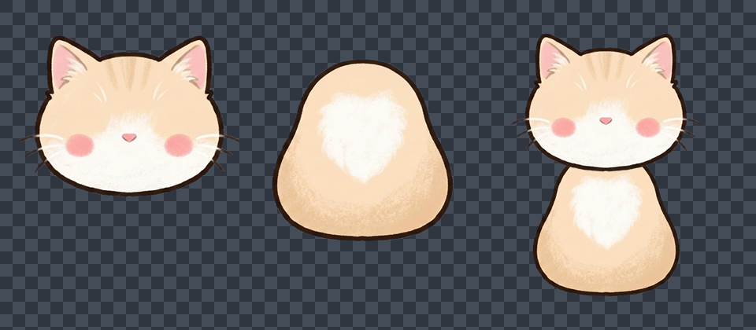
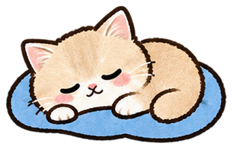

# 🐱 KuroCat · 虎宝专属 Live2D 桌宠版

<p align="center">
  <a href="https://github.com/Scorpioo4/kurocat-hubao/releases/latest"></a>
  <a href="./LICENSE"></a>
  
</p>

基于优秀开源项目 [qianyiai/kurocat](https://github.com/qianyiai/kurocat)（`v5.1.0`，MIT License）二次开发的**虎宝专属手绘 Live2D 桌面打字猫咪伴侣**，支持 **Windows 10/11** 与 **macOS（Apple Silicon M1–M4 & Intel 通用）**。

默认启动即为手绘贴纸风的**小猫「虎宝」**（同时完整保留原版全部猫咪皮肤、3D/2D 模式、65%/108 键、OBS 透明直播源与 MCP 捏猫功能）。

<p align="center">
  
  <br/>
  
</p>

---

## ✨ 虎宝专属版新增特性

- **🎨 手绘贴纸风 Live2D 全动态虎宝（默认皮肤）**：
  - 采用独立分离的**手绘圆脸头 + 无手团子身体**分层结构，搭配弹簧物理歪头、点头、2.5D 脸部偏转与唯一一体化粗棕描边小白肉爪。
- **🐾 5 大动态互动状态**：
  1. **常驻 / 晃鼠标观察**：微内聚萌态大绿眼（轻斗鸡眼）360° 丝滑追踪鼠标光标，小脑袋跟着轻轻歪头打量你，自然眨眼。
  2. **敲键盘生闷气打工**：一敲键盘立即切到平顶微斜碗形生闷气大眼（半眯着眼还会偷瞄键帽），左右小白爪交替拍键，按键盘最左侧近尾键（`Esc / Tab / Caps / Shift / Q / 1` 等）直接甩出蓬松大尾巴拍键，头顶飘出原版浅蓝叹气云。
  3. **摸脑袋开心大笑**：鼠标在虎宝头上来回抚摸，立刻变身弯弯笑眼张嘴大笑 + 高举双爪露出粉嫩小肉垫欢呼摇摆 + 温柔猫咪呼噜声 + 飘出粉红爱心与黄星星。
  4. **输密码防偷窥**：焦点进入系统密码框时，Rust 底层拦截按键不外传，虎宝自动切惊讶小 `O` 嘴并举起两只小白爪捂住大眼睛。
  5. **💤 新增 · 可配置自动睡眠模式**：支持在右键菜单第一页设置**无操作多少秒进入睡眠**（预设 `10秒 / 30秒 / 1分 / 3分 / 关闭`，并支持输入任意自定义秒数，默认 30 秒）。到时丝滑趴到**蓝色小云朵垫子**上慢呼吸呼呼大睡并飘出 `Zzz`，轻触键盘、鼠标或摸头即醒。
- **🖱️ 顺手菜单优化**：将「尺寸缩放（20%–150%）」与「💤 无操作进入睡眠」直接置于右键菜单首页，一开即调。

---

## 📥 下载与安装（Windows & macOS）

前往 [**Releases 页面**](https://github.com/Scorpioo4/kurocat-hubao/releases/latest) 下载对应系统的安装包：

### 🪟 Windows 10 / 11
- 下载 `KuroCat-*-x64-setup.exe`，双击安装即可（默认桌面右下角启动，开箱即为虎宝）。
- 若浏览器或 Windows SmartScreen 提示「未验证发布者」（个人开源未购商业代码签名），点击「保留」→「更多信息」→「仍要运行」即可。

### 🍎 macOS 10.15+（Apple Silicon M1–M4 & Intel 通用）
- 下载 `KuroCat-*-macos-universal.dmg`，双击挂载并将 `KuroCat.app` 拖入「应用程序」文件夹。
- **首次打开放行（开源未公证应用）**：若提示「无法验证开发者」或「已损坏」，在终端执行一次：
  ```bash
  xattr -cr /Applications/KuroCat.app
  ```
- **键鼠监听权限**：首次打开按引导在「系统设置 → 隐私与安全性」中勾选 **「辅助功能」** 与 **「输入监控」** 中的 `KuroCat` 即可正常响应敲键与鼠标。

---

## 🛠️ 本地构建

前置环境：Node.js 20+、Rust 工具链（`cargo`）。

```bash
git clone https://github.com/Scorpioo4/kurocat-hubao.git
cd kurocat-hubao
npm install
npm run tauri:dev      # 本地调试
npm run tauri:build    # 打包发布版本
```

---

## 📄 开源协议与致谢

- 本项目基于 [MIT License](./LICENSE) 开源。
- 衷心感谢上游开源项目 [**qianyiai/kurocat**](https://github.com/qianyiai/kurocat) 提供的优秀 Tauri v2 + Rust 跨平台桌宠底座。
- 原版内置「大肥鱼（鲸鱼娘）」素材基于 MIT 开源项目 [PC2005-cloud/dsh-pet](https://github.com/PC2005-cloud/dsh-pet) / [QCYTSN/dsh-dafeiyu](https://github.com/QCYTSN/dsh-dafeiyu)。
